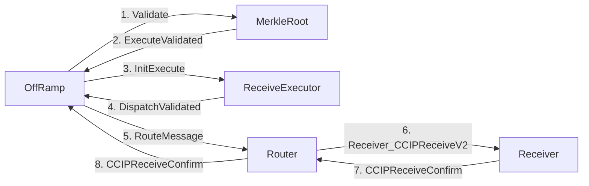
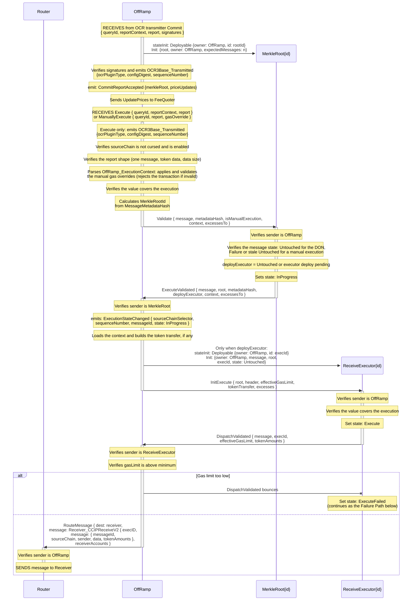
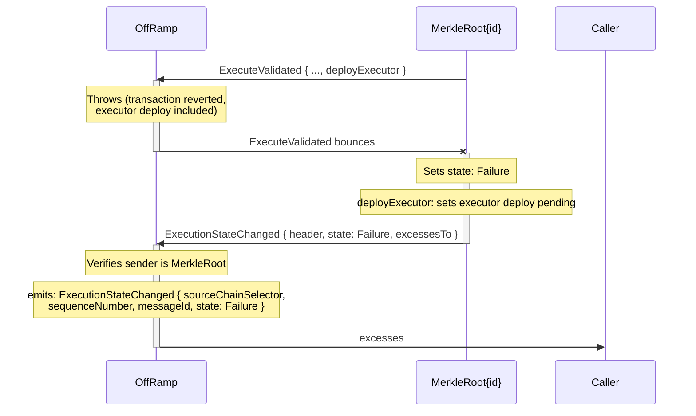
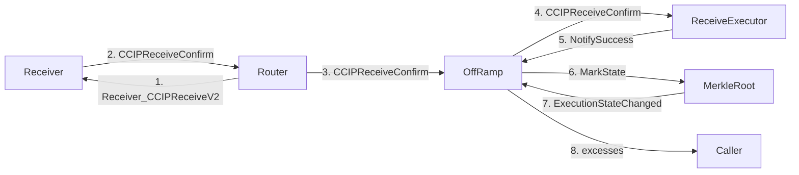
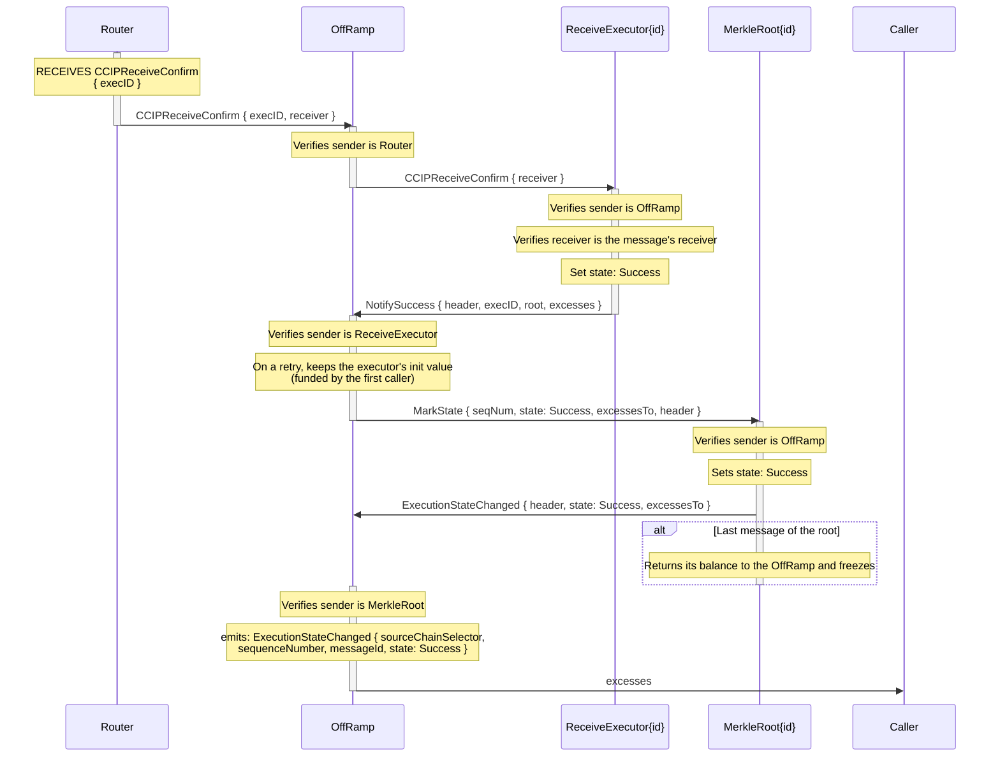
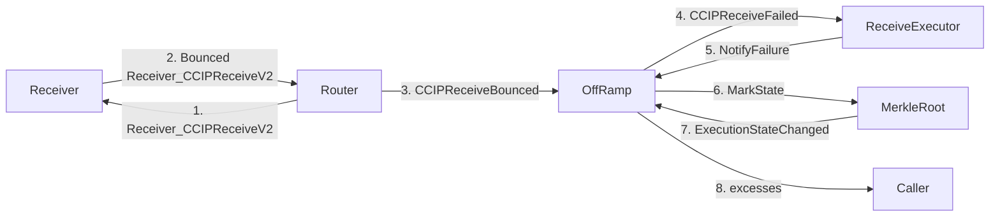
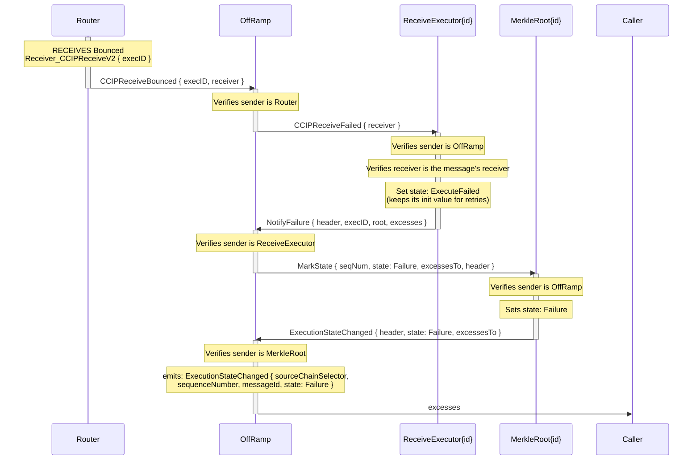

# Arbitrary Message OffRamp Flow

> See [how the ReceiveExecutor works](receive-executor.md) and [how the Token Registry is implemented](../token-pools/token-registry.md).

See also [MerkleRoot](./merkle-root.md) for the per-message execution state machine that drives retries and finalization, and [Token Transfer](./token-transfer.md) for messages that carry tokens.

See [user interface](../router/user-interface/receiver.md) for more details on communication between User and Router.

## Rejected Executions

An execution can be rejected at two points, and neither one leaves the message stuck:

- **Before the MerkleRoot is involved.** Invalid reports and invalid manual gas overrides make the
  `Execute` / `ManuallyExecute` transaction itself fail with the exit code of the check. Nothing
  changes on chain, and the message keeps its state.
- **After the MerkleRoot validated the message.** Anything that throws in `ExecuteValidated` (for
  example a message with an unsupported number of token transfers) reverts the whole OffRamp
  transaction, including the ReceiveExecutor deploy, and bounces back to the MerkleRoot. The root
  marks the message `Failure`, remembers that the executor still has to be deployed, and notifies
  the OffRamp, which emits the event and refunds the caller. The message can be manually executed
  right away, and that attempt deploys the executor.

## Receive Confirmation Flow

The ExecutionStateChanged event for the final state is emitted only once the MerkleRoot has
committed that state, when it answers `MarkState` with `ExecutionStateChanged`.

### Happy Path

### Failure Path

The failed message can then be retried with `ManuallyExecute`, which reuses the same
ReceiveExecutor.
