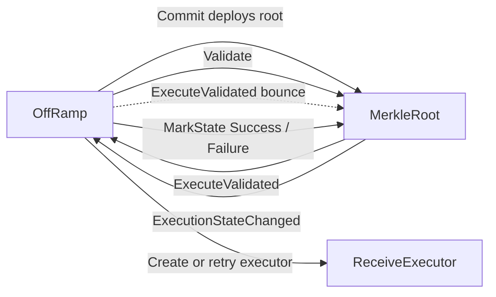
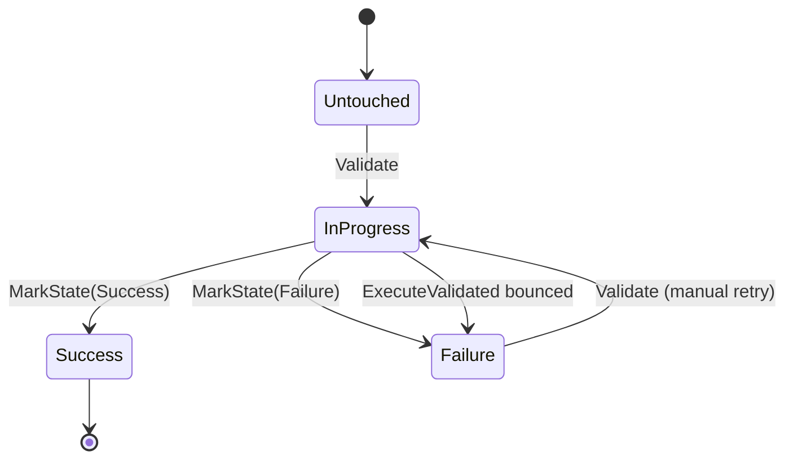
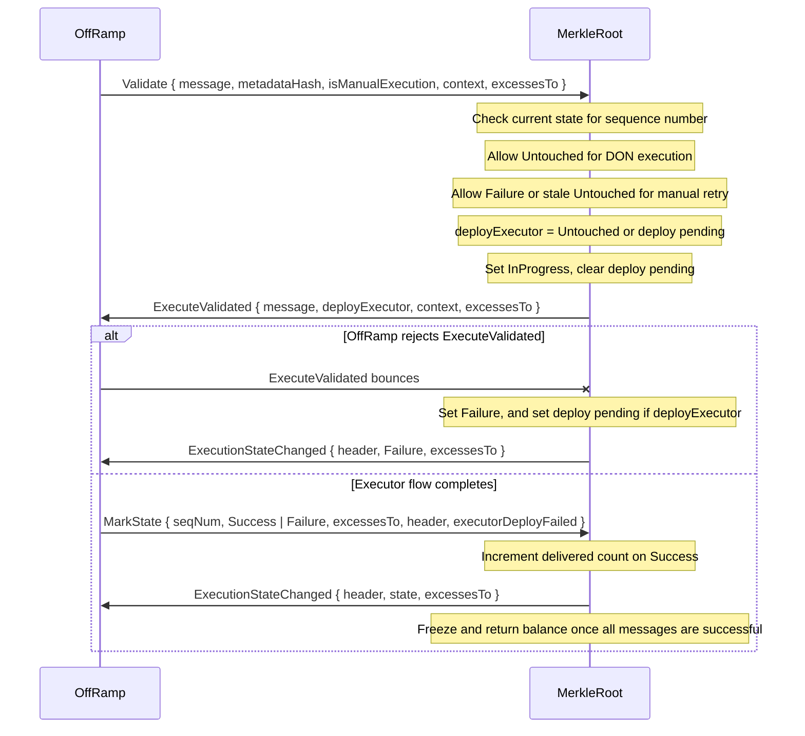

# MerkleRoot

The MerkleRoot contract is deployed once per committed root. It tracks execution state for every message sequence number covered by that root and acts as the gatekeeper for retries. The OffRamp uses it to prove that a message belongs to a committed report before creating or reusing a `ReceiveExecutor`.

Each message state is stored in a packed two-bit bitmap keyed by sequence number offset. A second, one-bit bitmap records which messages still need their `ReceiveExecutor` deployed although they are no longer `Untouched` (see [Executor Deployment](#executor-deployment)). A single MerkleRoot can track up to 64 messages.



## State Machine

The state machine is per message, not per contract.



## Transition Rules

- `Untouched -> InProgress`: the OffRamp sends `Validate` after checking the execute report and parsing the execution context. Normal DON execution is only allowed from `Untouched`; manual execution is allowed from `Untouched` once the permissionless threshold has passed.
- `InProgress -> Success`: the OffRamp sends `MarkState(Success)` after the `ReceiveExecutor` confirms delivery.
- `InProgress -> Failure` (`MarkState`): the OffRamp sends `MarkState(Failure)` after a bounced delivery or failed execution path.
- `InProgress -> Failure` (bounce): the OffRamp rejected `ExecuteValidated`, so its whole transaction was reverted. See [Executor Deployment](#executor-deployment).
- `Failure -> InProgress`: a manual retry is allowed as soon as execution failed, without waiting for the permissionless threshold. The DON never re-executes a failed message.
- `Success` is terminal: the contract rejects any later transition away from success.

Every state change is answered with `ExecutionStateChanged`, which carries the caller's excesses back to the OffRamp. The OffRamp emits the `ExecutionStateChanged` event only then, so the event always reflects the state the root committed.

## Executor Deployment

The OffRamp deploys a message's `ReceiveExecutor` in the same transaction that handles `ExecuteValidated`. If that transaction is reverted, the deploy is reverted with it, so the root tells the OffRamp whether the attempt must deploy the executor:

```
deployExecutor = state == Untouched || executor deploy pending
```

- `Validate` sends `deployExecutor` on `ExecuteValidated` and clears the pending bit.
- A bounced `ExecuteValidated` marks the message `Failure` and sets the pending bit again if the bounced attempt carried `deployExecutor = true`. A retry of a message whose executor already exists bounces back to a plain `Failure`.
- `MarkState` with `executorDeployFailed = true` (sent by the OffRamp when the executor's `Deployable_Initialize` bounced) sets the pending bit. Only `Validate` clears it, so the plain `Failure` reported right after by the bounced `InitExecute` cannot undo it.

As a result, a message is past `Untouched` without a pending bit only when its executor exists, so any rejected attempt can be retried.

## Root Lifecycle



The `context` is opaque to the root: it is the `OffRamp_ExecutionContext` the OffRamp parsed from the report and the manual gas overrides, relayed unchanged so the OffRamp does not validate it again.

The root only freezes when every message in its interval has eventually reached `Success`. Failed messages keep the root alive so they can be retried.
