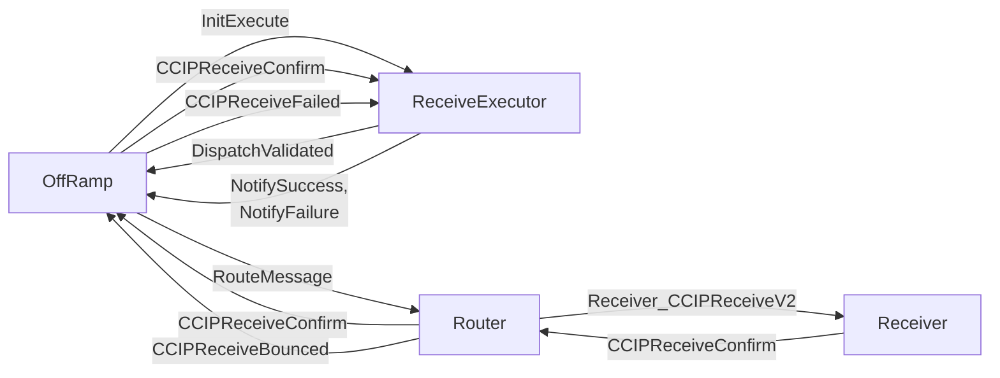
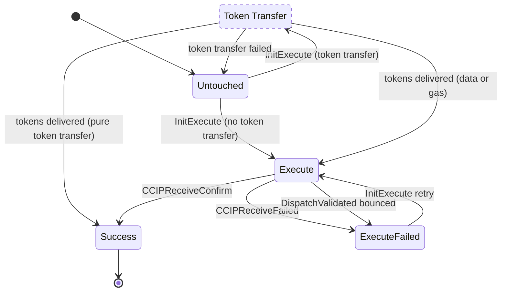
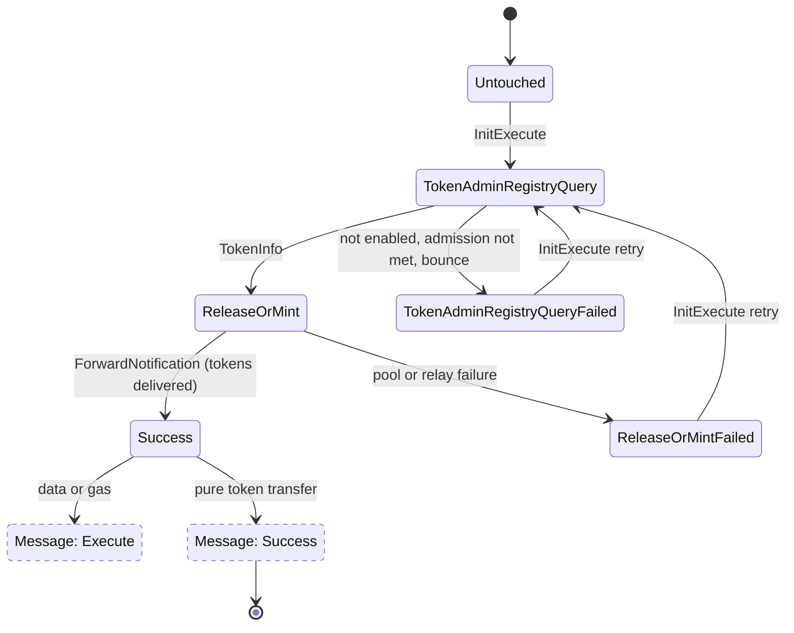

# ReceiveExecutor

The ReceiveExecutor is the execution-tracking contract used by the OffRamp to persist one incoming CCIP message at a deterministic address. It stores the message content, the root address, the execution id, the current message state, and the last execution timestamp.

The OffRamp deploys the ReceiveExecutor on the first execution attempt of a message, and reuses it on every retry. The [MerkleRoot](./merkle-root.md#executor-deployment) tells the OffRamp whether an attempt must deploy it (`deployExecutor`), so an attempt whose deploy was reverted or bounced is followed by one that deploys it again. From there, the ReceiveExecutor tracks whether the message is currently being executed, has failed, or has been confirmed successfully.

## State Machine

The ReceiveExecutor tracks two states: the message execution, and, for a message with a token transfer, the token transfer. They hand over to each other: a message with a token transfer stays `Untouched` while its tokens move, and the delivered token transfer starts the message execution. Dashed states belong to the other state machine.

### Message Execution State

- `Untouched -> Execute`: the OffRamp sends `InitExecute` for a message without a token transfer. The executor checks the value covers the execution (otherwise it reports `NotifyFailure` and stays `Untouched`), stores the current timestamp and sends `DispatchValidated` to the OffRamp.
- `Untouched -> Token Transfer`: `InitExecute` for a message with a token transfer starts the [token transfer](#token-transfer-state). The message stays `Untouched` while the tokens move, and an `InitExecute` that arrives meanwhile is rejected (`ExecutionAlreadyInProgress`). A failed token transfer reports `NotifyFailure` and leaves the message `Untouched`, so a retry starts the token transfer again.
- `Token Transfer -> Execute`: once the deposit account reports the delivery, the executor sends `TokenTransferDelivered` (the delivery report to the pool, independent of the message execution) and then `DispatchValidated`, whose `tokenAmounts` carry the amount the deposit account actually received.
- `Token Transfer -> Success`: a pure token transfer (no data and `gasLimit == 0`) has nothing to execute, so the delivery finishes the message with `NotifySuccess`, which carries the delivery report.
- `Execute -> Success`: the Receiver confirms delivery through Router and OffRamp, and the OffRamp forwards `CCIPReceiveConfirm` to the ReceiveExecutor, which reports `NotifySuccess` with its whole balance.
- `Execute -> ExecuteFailed`: the routed receive message bounces and the OffRamp forwards `CCIPReceiveFailed`, or the OffRamp rejects `DispatchValidated` (for example a gas limit below the minimum). The executor reports `NotifyFailure` and keeps its init value for retries.
- `ExecuteFailed -> Execute`: the same ReceiveExecutor is retried on a later manual execution. The tokens are already delivered, so the retry sends `DispatchValidated` directly, with the same delivered amount.
- `Success` is terminal in practice because the contract returns its balance to the OffRamp and freezes.

Every `NotifySuccess` / `NotifyFailure` makes the OffRamp send `MarkState` to the MerkleRoot; the `ExecutionStateChanged` event is emitted once the root answers.

The message execution state is used together with [MerkleRoot](./merkle-root.md), which keeps the canonical per-message execution state for the whole committed root.

This serves to recover the message state in three situations:

1. When we get a bounced message from the receiver.
2. When the receiver confirms the execution.
3. When doing manual execution, validating the message was marked as failed.

### Token Transfer State

A message with a token transfer also tracks the transfer, so a retry resumes from the step that failed (see [Token Transfer](./token-transfer.md)):

A retry after a release-or-mint failure queries the TokenAdminRegistry again, so a pool re-pointed since the failed attempt is used. `Success` is final for the token transfer: it hands over to the message execution, and later retries skip the tokens and go straight to `Execute`.
