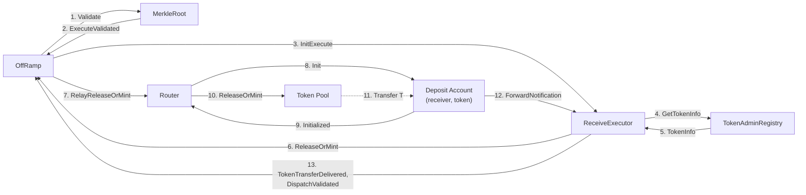
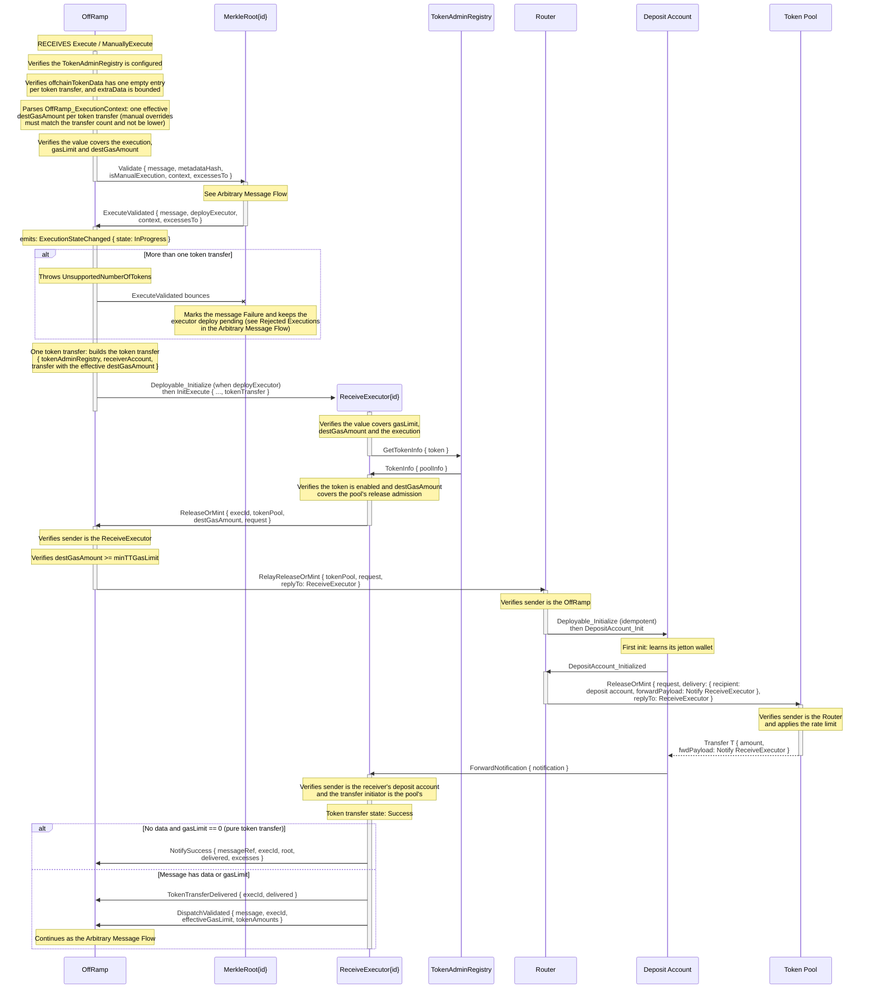
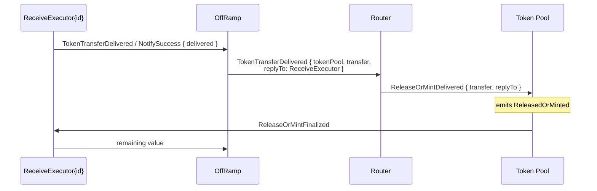

# Token Transfer Offramp Flow

> Before you read, see [Jetton Transfer Notation Convention](../../token-transfer-notation-convention.md): a dotted arrow is a jetton transfer.

> See also the [Arbitrary Message Flow](./arbitrary-msg.md), which this flow continues once the tokens are delivered, and [how the Token Registry is implemented](../token-pools/token-registry.md).

A message carries at most one token transfer. The tokens are released or minted by the token's pool into the receiver's **deposit account** for that token (owned by the Router), and the ReceiveExecutor only continues with the message once the deposit account reports the delivery.

## Release or Mint

## Delivery Report

Once the deposit account reports the delivery, the OffRamp relays it to the pool, which emits `ReleasedOrMinted`. The report is independent of the message execution: the receiver may never confirm, but the tokens are already in its deposit account.

A pure token transfer (no data, `gasLimit == 0`) ends here: the OffRamp sends `MarkState(Success)` to the MerkleRoot, which answers with `ExecutionStateChanged`, and the OffRamp emits the event and refunds the caller (see [Receive Confirmation Flow](./arbitrary-msg.md#receive-confirmation-flow)). A message with data or gas is finalized by the receiver's confirmation or bounce, as an arbitrary message.

## Failure Paths

Every failure on the token path ends the execution with `NotifyFailure`, which the OffRamp turns into `MarkState(Failure)`. The token transfer state records the failed step, so a manual retry resumes from there.

| Failure                                                          | Detected by                                         | Reported as                                                                                                                 |
| ---------------------------------------------------------------- | --------------------------------------------------- | --------------------------------------------------------------------------------------------------------------------------- |
| More than one token transfer                                     | OffRamp, `ExecuteValidated`                         | transaction fails with `UnsupportedNumberOfTokens`; the bounce marks the message `Failure` with the executor deploy pending |
| Not enough value for gasLimit and destGasAmount                  | ReceiveExecutor, `InitExecute`                      | `NotifyFailure` (state unchanged)                                                                                           |
| Token not enabled, or destGasAmount below the pool's admission   | ReceiveExecutor, `TokenInfo` / `GetTokenInfoFailed` | `NotifyFailure`, token state `TokenAdminRegistryQueryFailed`                                                                |
| TokenAdminRegistry query bounced                                 | ReceiveExecutor                                     | `NotifyFailure`, token state `TokenAdminRegistryQueryFailed`                                                                |
| destGasAmount below `minTTGasLimit`                              | OffRamp, `ReleaseOrMint`                            | `ReceiveExecutor_ReleaseOrMintFailed`, then `NotifyFailure`                                                                 |
| Lane cursed, pool bounced the relay, deposit account init failed | Router                                              | `Router_TokenPoolReleaseOrMintFailed` to the OffRamp, then `ReceiveExecutor_ReleaseOrMintFailed`, then `NotifyFailure`      |
| Pool rejected the release (e.g. rate limit)                      | Token Pool                                          | `TokenPool_ReleaseOrMintFailure` to the ReceiveExecutor, then `NotifyFailure`                                               |

A retry after a release-or-mint failure queries the TokenAdminRegistry again, so a pool re-pointed since the failed attempt is used. A retry after the tokens were delivered skips straight to the message execution.
